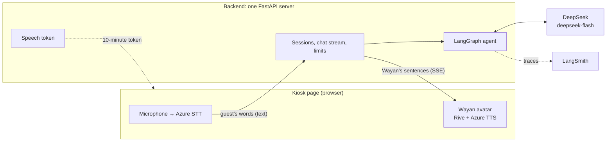
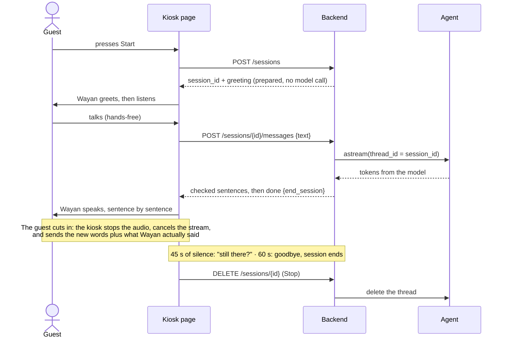
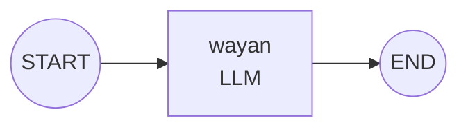
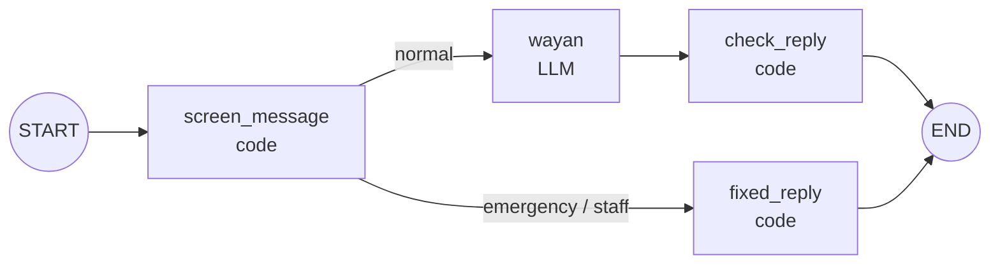

# Architecture — Wayan, the Little Host

How the chatbot is built, and why. What we build and for whom: [prd.md](prd.md). Order of work: [roadmap.md](roadmap.md).

**Status:** design for v1. Only the baseline graph (§4.1) is built so far. **Updated:** 2026-10-24

---

## 1. The big picture



| Part | Job | Where |
|---|---|---|
| Kiosk page | Start and Stop buttons, microphone and speech-to-text, cut-in detection, idle timers; plays Wayan's sentences through the avatar | `web/`, copied from `new_avatar_ai/web` at build step 16 |
| Backend | One FastAPI server: serves the kiosk page, hands out short-lived Azure speech tokens (ported from the avatar's `server.py`), runs sessions and the chat stream, enforces limits | `src/backend/`, build step 10 |
| Agent | The LangGraph graph that decides what Wayan says | `src/agent/` |
| DeepSeek | The model | DeepSeek API |
| LangSmith | Traces and evaluations | Cloud, project `avatar-chatbot` |

Speech stays in the browser, as it already does in the avatar: the server only ever sees text. That keeps audio off our server and reuses the avatar's tested speech code.

## 2. Key decision: how the agent runs

**Choice: A — the graph is called directly inside the backend.** The backend imports the graph and streams it with `graph.astream(...)`, and we set up the checkpointer ourselves.

| | **A. Graph in the backend** ✅ | B. LangGraph Agent Server |
|---|---|---|
| Servers | One. It also serves the kiosk page and the speech token | Two: the Agent Server, plus a backend for the page and the token |
| Stream format | Our own: checked sentences, then an end signal | The server's events, which we would translate anyway |
| Cut-ins | We cancel our own request; keeping only the spoken part is custom logic either way | Built-in "double texting" (interrupt or rollback) helps, but not with the spoken part |
| Threads | Ours. Short sessions in memory are enough | Built in, with Postgres in production |
| Deploy | `uvicorn` on a small VPS | The Agent Server container plus a database |

Why A: the kiosk needs its own stream format, sessions last minutes and don't need to survive a restart, and one small server is easier to run for a demo. `langgraph dev` and Studio are still the development tools (build steps 8 and 9), because the same graph runs there unchanged.

## 3. One conversation, step by step



The kiosk's states: `waiting` (Start is shown) → `greeting` → `listening` ⇄ `thinking` → `speaking` → `listening` … → `ending` → `waiting`. A cut-in moves `speaking` straight back to `listening`.

Backend endpoints (build steps 10 and 13):

| Endpoint | Does |
|---|---|
| `POST /sessions` | Makes a session ID, stores a random prepared greeting in the new thread, and returns both |
| `POST /sessions/{id}/messages` | Takes the guest's text (and, after a cut-in, what Wayan actually said) and streams the reply as server-sent events |
| `POST /sessions/{id}/idle` | At 45 s returns the "still there?" line; at 60 s returns the goodbye and ends the session. Both lines are stored in the thread |
| `DELETE /sessions/{id}` | Stop: ends the session and deletes its thread |
| `GET /api/speech-token` | A 10-minute Azure Speech token; the key never leaves the server |
| `GET /health` | For monitoring |

When a reply ends the session (`[bye]` or the turn limit), the backend ends it after sending `done`.

## 4. The graph

### 4.1 Now: the baseline (build step 8)



One node: the system prompt (persona and speaking rules, `src/agent/prompts.py`) followed by the conversation, sent to DeepSeek. There is no knowledge yet, so the baseline will make up hotel facts when asked. That is expected: the knowledge milestone fixes it, and the evals prove the fix.

### 4.2 Target for v1 (built one feature at a time in build step 9)



| Node | Type | Job |
|---|---|---|
| `screen_message` | Code (rules) | Tidies the guest's text (trims it, cuts it at 300 characters) and spots clear emergencies and requests for a person with keyword rules, before any model call. Writes `route` |
| `fixed_reply` | Code | Adds the fixed line for that route (prd.md §11) |
| `wayan` | LLM | Writes Wayan's reply from the persona, the knowledge pack, the current Bali time, and the conversation |
| `check_reply` | Code | Enforces the reply contract (§5): keeps known tags only, strips markdown, emoji, and links, cuts at 400 characters at a sentence end, turns `[bye]` into `end_session`, and swaps a `[help]` reply for the fixed emergency line |

The route is decided inside `screen_message`; the edge only reads `route` from the state.

Why keyword rules rather than a classifier model for the screen: a second model call would add about a second to every turn, and voice can't afford that. The model is the backstop: its prompt tells it to answer only `[help]` when someone may be in danger, and `check_reply` turns that into the fixed line. If the safety evals show misses, we add a fast classifier as in CareDesk. The rules need care, because "help" also appears in normal questions ("can you help me find the spa?"); the evals include such look-alikes.

State, shared by all nodes:

```python
class State(MessagesState):
    # messages: the conversation, with the add_messages reducer
    route: Literal["normal", "emergency", "staff"]  # written by screen_message
    end_session: bool  # written by check_reply
```

Runtime context, given per run and not stored in the thread:

```python
@dataclass
class Context:
    # Where the run comes from: "studio", "kiosk", "eval" or "test" (built)
    channel: str = "studio"
    # None means the current Bali time; evals pass a fixed time (milestone 3)
    now: datetime | None = None
```

### 4.3 The prompt

The order matters for DeepSeek's prompt cache, which bills a repeated beginning of a prompt at about 2% of the normal input price. What never changes goes first, so it stays cached across turns and guests:

1. Persona and rules (prd.md §6 and §10): fixed
2. `knowledge/hotel.md` and `knowledge/bali-culture.md`: fixed, read once at startup
3. The current Bali date, weekday, and time (Asia/Makassar, WITA): changes every run, so it comes last in the system part
4. The conversation

Knowledge goes in whole, without retrieval: the two files are about 2,300 words (roughly 3,000 tokens), so there's nothing to search and nothing a search could miss.

## 5. The reply contract (agent → kiosk)

- Plain English text with tags. Face and gesture tags are the avatar's English names: `[smile] [neutral] [surprised] [sad] [laugh] [thumbsup]`. Two control tags are never spoken: `[bye]` and `[help]`.
- No markdown, emoji, links, or lists. At most 400 characters per reply (the avatar's limit); about 250 is the target.
- The backend sends one event per checked sentence, so Wayan starts talking after the first sentence instead of after the whole reply. The same check function runs on each streamed sentence and on the final stored message, so what Wayan says and what the thread remembers match.

| Event (SSE) | Data |
|---|---|
| `sentence` | `{index, text}`: one checked sentence, tags included |
| `done` | `{message_id, end_session}` |
| `error` | `{text}`: the fixed error line |

## 6. Memory and sessions

- **Development:** `langgraph dev` stores threads itself, so `graph.py` compiles the graph without a checkpointer (as in CareDesk).
- **Backend:** `build_graph(checkpointer=InMemorySaver())`. Sessions last minutes and nothing has to survive a restart, so memory is enough. When a session ends, its thread is removed with the checkpointer's `adelete_thread`.
- `thread_id` is the `session_id`, a random UUID from `POST /sessions`.
- The greeting and the idle lines are added to the thread as AI messages by the backend (`graph.aupdate_state`), so the model knows what Wayan already said.
- **Cut-ins:** with its next message, the kiosk sends `{message_id, spoken_text}`. The backend replaces that AI message with the spoken part under the same message ID, so `add_messages` replaces it instead of appending. (Check the exact `aupdate_state` call against the docs at build step 13.)

## 7. Limits (backend)

| Limit | Value | When it's hit |
|---|---|---|
| Guest turns per session | 20 | Fixed goodbye; the session ends |
| Guest text | 300 characters | Cut |
| Model output | 200 tokens (`max_tokens`) | Cut, then `check_reply` ends the reply at a sentence |
| Model timeout | 20 s, 1 retry | Fixed error line |
| Daily spend, online only | about $0.16 | Fixed "resting" line |

## 8. Model settings

| Setting | Value | Why |
|---|---|---|
| Model | `deepseek-flash` (DeepSeek-V4.1-Flash) | Fast and cheap. Checked against DeepSeek's `GET /models` on 2026-10-24: the only other model is `deepseek-v4-pro` |
| Thinking | Off: `extra_body={"thinking": {"type": "disabled"}}` | Thinking is on by default and would add seconds before Wayan can speak |
| Temperature | DeepSeek's default for now | Tuned with the persona evals in build step 9 |
| Max output | 200 tokens | Replies are short; it also caps cost |
| Timeout and retries | 20 s, 1 retry | A guest is standing there waiting |

The model is created on first use (`default_model()`), so the graph imports without an API key and unit tests use a fake model (the CareDesk pattern).

## 9. Tracing

- LangSmith is on from day one (build step 7): `LANGSMITH_TRACING=true`, project `avatar-chatbot`, US region (so no `LANGSMITH_ENDPOINT`, as in CareDesk).
- From build step 9, every run carries `session_id` and `channel` (`studio`, `kiosk`, `eval`) as metadata, so traces can be filtered by session and source.
- Traces hold the guest's words but no personal data (Wayan never asks for any) and no audio.

## 10. Repository layout

```
avatar-chatbot/
├── AGENTS.md          instructions for AI coding assistants (CLAUDE.md imports it)
├── README.md          how to run it
├── docs/              prd.md · architecture.md · roadmap.md
├── knowledge/         hotel.md · bali-culture.md (prompt content)
├── src/agent/         graph.py · prompts.py (from the LangGraph template)
├── src/backend/       FastAPI app (build step 10, not yet)
├── web/               kiosk page (build step 16, not yet)
├── tests/             unit_tests/ · integration_tests/
├── langgraph.json     where the graph is, for `langgraph dev`
└── pyproject.toml     dependencies, managed with uv
```

## 11. Decisions

| # | Decision | Why |
|---|---|---|
| 1 | The graph runs inside the backend (option A) | One server, our own stream format, short sessions |
| 2 | Knowledge goes into the prompt whole; no retrieval | Two small files: nothing to miss, and cheap with prompt caching |
| 3 | Control tags (`[bye]`, `[help]`) instead of tool calls | They stream in order with the words, and need no extra round trip before Wayan speaks |
| 4 | The reply contract is enforced in code | A prompt can be talked around; code can't (the CareDesk lesson) |
| 5 | A rules screen before the model, with the model as backstop | No extra model call, so no extra wait, on every turn |
| 6 | Thinking mode off | Speed |
| 7 | Speech in the browser, text on the server | Reuses the avatar's speech code; no audio on our server |
| 8 | Sessions in memory, deleted when they end | Nothing should outlive a guest's session |
| 9 | Fixed lines for the greeting, idle, safety, and errors | Instant, predictable, and testable |
| 10 | English tag names | The prompt and replies are in English; the avatar accepts both |
