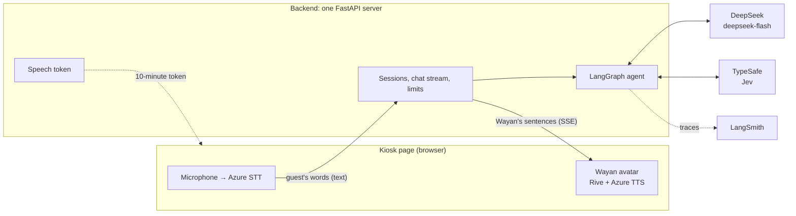
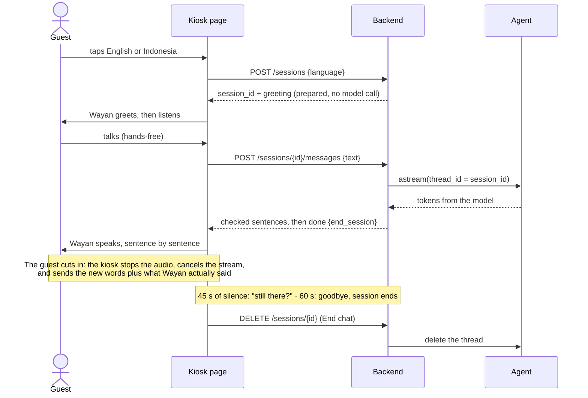
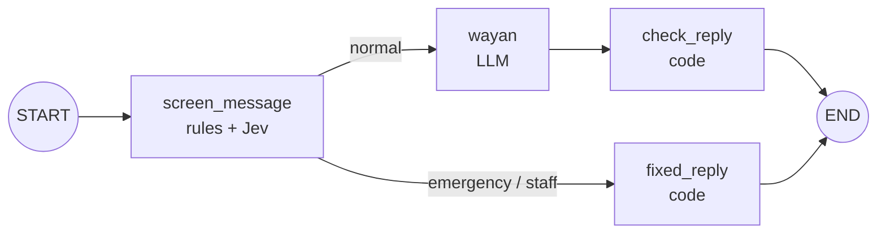

# Architecture — Wayan, the Little Host

How the chatbot is built, and why. What we build and for whom: [prd.md](prd.md). Order of work: [roadmap.md](roadmap.md).

**Status:** v1 built through roadmap milestone 7: the graph (§4.2), the backend (§3), and the kiosk page. Not yet deployed. **Updated:** 2026-10-28

---

## 1. The big picture



| Part | Job | Where |
|---|---|---|
| Kiosk page | Language buttons that start a session, suggested questions, End chat, microphone and speech-to-text, cut-in detection, idle timers; plays Wayan's sentences through the avatar | `web/index.html`, built from `new_avatar_ai/web` |
| Backend | One FastAPI server: serves the kiosk page (with `Cache-Control: no-cache`, so a changed page is never served from a stale browser copy), hands out short-lived Azure speech tokens (ported from the avatar's `server.py`), runs sessions and the chat stream, enforces limits | `src/backend/` |
| Agent | The LangGraph graph that decides what Wayan says | `src/agent/` |
| DeepSeek | The model | DeepSeek API |
| TypeSafe Jev | The screen's second look: answers typed yes/no questions about a guest's message, no text | TypeSafe API |
| LangSmith | Traces and evaluations | Cloud, project `avatar-chatbot` |

Speech stays in the browser, as it already does in the avatar: the server only ever sees text. That keeps audio off our server and reuses the avatar's tested speech code.

## 2. Key decision: how the agent runs

**Choice: A — the graph is called directly inside the backend.** The backend imports the graph and streams it with `graph.astream(...)`, and we set up the checkpointer ourselves.

| | **A. Graph in the backend** ✅ | B. LangGraph Agent Server |
|---|---|---|
| Servers | One. It also serves the kiosk page and the speech token | Two: the Agent Server, plus a backend for the page and the token |
| Stream format | Our own: checked sentences, then an end signal | The server's events, which we would translate anyway |
| Cut-ins | We cancel our own request; keeping only the spoken part is custom logic either way | Built-in "double texting" (interrupt or rollback) helps, but not with the spoken part |
| Threads | Ours. Short sessions in memory are enough | Built in, with Postgres in production |
| Deploy | `uvicorn` on a small VPS | The Agent Server container plus a database |

Why A: the kiosk needs its own stream format, sessions last minutes and don't need to survive a restart, and one small server is easier to run for a demo. `langgraph dev` and Studio are still the development tools (build steps 8 and 9), because the same graph runs there unchanged.

## 3. One conversation, step by step



The kiosk's states: `waiting` (the language buttons are shown) → `greeting` → `listening` ⇄ `thinking` → `speaking` → `listening` … → `ending` → `waiting`. A cut-in moves `speaking` straight back to `listening`.

Backend endpoints (build steps 10 and 13):

| Endpoint | Does |
|---|---|
| `POST /sessions` | Takes the guest's language (`en` or `id`, default `en`), makes a session ID, stores a random prepared greeting in the new thread, and returns both, plus the error line the page says when the backend can't be reached. Every fixed line after that is in the session's language |
| `POST /sessions/{id}/messages` | Takes the guest's text (and, after a cut-in, what Wayan actually said) and streams the reply as server-sent events |
| `POST /sessions/{id}/idle` | At 45 s returns the "still there?" line; at 60 s returns the goodbye and ends the session. Both lines are stored in the thread |
| `DELETE /sessions/{id}` | End chat: ends the session and deletes its thread |
| `GET /api/speech-token` | A 10-minute Azure Speech token; the key never leaves the server |
| `GET /health` | For monitoring |

When a reply ends the session (`[bye]` or the turn limit), the backend ends it after sending `done`.

## 4. The graph

### 4.1 How it grew

Build step 8 started with one node, `wayan`; milestone 2 added `check_reply`, milestone 4 the screen and the fixed replies. §4.2 is the graph as it is now.

### 4.2 The graph now (v1)



| Node | Type | Job |
|---|---|---|
| `screen_message` | Code (rules) + Jev | Tidies the guest's text (trims it, cuts it at 300 characters) and spots emergencies and requests for a person before Wayan's model: keyword rules first, then Jev for what the rules let through. Writes `route` |
| `fixed_reply` | Code | Adds the fixed line for that route (prd.md §11) |
| `wayan` | LLM | Writes Wayan's reply from the persona, the knowledge pack, the current Bali time, and the conversation |
| `check_reply` | Code | Enforces the reply contract (§5): keeps known tags only, strips markdown, emoji, and links, cuts at 400 characters at a sentence end, turns `[bye]` into `end_session` (unless the guest's message asked something: the idle timer can end that session, a mistaken end can't be undone), and swaps a `[help]` reply for the fixed emergency line |

The route is decided inside `screen_message`; the edge only reads `route` from the state.

The screen has three layers:

1. **Keyword rules** (`screen.py`), in English and Indonesian. Instant and offline, so a clear "call an ambulance" never waits on a network call. They need care, because "help" also appears in normal questions ("can you help me find the spa?"); the tests and evals include such look-alikes.
2. **Jev** (TypeSafe's decision model), only for messages the rules let through. One request asks four yes/no questions (Nouls): is someone hurt, is there a danger, is a person missing, does the guest want staff (`screen_questions.py`, with the threshold). Code picks the route: any emergency question at 0.7 or above wins, then staff. Jev returns probabilities, not text, so there is nothing to parse. It catches what no keyword list can ("my husband just collapsed", "bisa panggilin orang hotel?"). If Jev fails, has no key, or takes over 1.5 s, the message goes on as normal and a warning is logged.
3. **Wayan's model**, the backstop: its prompt tells it to answer only `[help]` when someone may be in danger, and `check_reply` turns that into the fixed line.

Jev was first ruled out because a second model call would add about a second to every turn. Measured 2026-10-28, Jev takes 0.35 s median (0.5 s p90) on a warm connection and about 1 s for the first call, so it now runs on every message the rules pass. Over 35 test messages it routed all of them right, 13 of them messages the rules missed. The model is pinned (`jev-1.14.0`), because the threshold was tuned on it.

Open points: Jev's wait comes before Wayan's model starts, so every normal message now reaches its first sentence about 0.35 s later (on top of the 1.01 s median in §8). And 35 test messages are not many: the 0.7 threshold should be checked again on real guest conversations, and on the safety evals, before it is trusted.

State, shared by all nodes:

```python
class State(MessagesState):
    # messages: the conversation, with the add_messages reducer
    route: Literal["normal", "emergency", "staff"]  # written by screen_message
    end_session: bool  # written by check_reply
```

Runtime context, given per run and not stored in the thread:

```python
@dataclass
class Context:
    # Where the run comes from: "studio", "kiosk", "eval" or "test" (built)
    channel: str = "studio"
    # None means the current Bali time; evals pass a fixed time (milestone 3)
    now: datetime | None = None
    # The session's language, "en" or "id": picks the LANGUAGE note and the fixed lines
    language: Literal["en", "id"] = "en"
```

### 4.3 The prompt

The order matters for DeepSeek's prompt cache, which bills a repeated beginning of a prompt at about 2% of the normal input price. What never changes goes first, so it stays cached across turns and guests:

1. Persona and rules (prd.md §6 and §10): fixed
2. `knowledge/hotel.md` and `knowledge/bali-culture.md`: fixed, read once at startup
3. The session's LANGUAGE note: English or Indonesian, from the runtime context
4. The current Bali date, weekday, and time (Asia/Makassar, WITA): changes every run, so it comes last in the system part
5. The conversation

Knowledge goes in whole, without retrieval: the two files are about 2,300 words (roughly 3,000 tokens), so there's nothing to search and nothing a search could miss. The whole system prompt, persona and notes included, is about 17,000 characters (roughly 4,300 tokens, measured 2026-10-28): a few percent of the model's context, and the part that is the same for every guest comes first, so the prompt cache keeps it.

## 5. The reply contract (agent → kiosk)

- Plain text in the session's language, with tags. Face and gesture tags are the avatar's English names: `[smile] [neutral] [surprised] [sad] [laugh] [thumbsup] [salam]` (`[salam]` only opens the fixed greetings). Two control tags are never spoken: `[bye]` and `[help]`.
- No markdown, emoji, links, or lists. At most 400 characters per reply (the avatar's limit); about 250 is the target.
- The backend sends one event per checked sentence, so Wayan starts talking after the first sentence instead of after the whole reply. The same check function runs on each streamed sentence and on the final stored message, so what Wayan says and what the thread remembers match.

| Event (SSE) | Data |
|---|---|
| `sentence` | `{index, text}`: one checked sentence, tags included |
| `done` | `{message_id, end_session}` |
| `error` | `{text}`: the fixed error line |

## 6. Memory and sessions

- **Development:** `langgraph dev` stores threads itself, so `graph.py` compiles the graph without a checkpointer (as in CareDesk).
- **Backend:** `build_graph(checkpointer=InMemorySaver())`. Sessions last minutes and nothing has to survive a restart, so memory is enough. When a session ends, its thread is removed with the checkpointer's `adelete_thread`.
- `thread_id` is the `session_id`, a random UUID from `POST /sessions`.
- The greeting and the idle lines are added to the thread as AI messages by the backend (`graph.aupdate_state`), so the model knows what Wayan already said.
- **Cut-ins:** with its next message, the kiosk sends `{message_id, spoken_text}`. The backend replaces that AI message with the spoken part under the same message ID, so `add_messages` replaces it instead of appending. (Check the exact `aupdate_state` call against the docs at build step 13.)

## 7. Limits (backend)

| Limit | Value | When it's hit |
|---|---|---|
| Guest turns per session | 20 | Fixed goodbye; the session ends |
| Guest text | 300 characters | Cut |
| Model output | 2000 tokens (`max_tokens`, thinking included; Indonesian jokes can think ~800) | Cut, then `check_reply` ends the reply at a sentence |
| Model timeout | 20 s, 1 retry | Fixed error line |
| Daily spend, online only | `DAILY_BUDGET_USD`, about $0.16 (estimated in `budget.py`, kept in memory) | Fixed "resting" line; the session ends |

## 8. Model settings

| Setting | Value | Why |
|---|---|---|
| Model | `deepseek-flash` (DeepSeek-V4.1-Flash) | Fast and cheap. Checked against DeepSeek's `GET /models` on 2026-10-24: the only other model is `deepseek-v4-pro` |
| Thinking | On, low effort: `reasoning_effort="low"`, `extra_body={"thinking": {"type": "enabled"}}` | Measured 2026-10-24 (10 tries each): thinking off answered "is the pool open now?" at 7 pm right 5/10 times, low effort 10/10. The first sentence comes 0.76 s (max 1.14 s) without thinking and 1.01 s (max 1.79 s) with it: within §12's targets. The default effort is high and much slower |
| Thinking for jokes | Minimal effort when the guest asks for a joke, riddle, or funny story (`JOKE_REQUEST` in `graph.py`) | Measured 2026-10-26: Indonesian jokes waited 5.6 s median (up to 14 s) at low effort, 4.7 s (up to 8 s) at minimal, still funny; thinking off took 2 s but the jokes were flat. Told to take its first idea, the model told everyone the same riddle, so a joke turn also gets a random story topic and riddle kind (`joke_note`). The kiosk says a filler line after 2 s |
| Temperature | DeepSeek's default for now | Tuned with the persona evals in build step 9 |
| Max output | 2000 tokens | Thinking counts toward it; `check_reply` still limits what is said to 400 characters |
| Timeout and retries | 20 s, 1 retry | A guest is standing there waiting |

The model is created on first use (`default_model()`), so the graph imports without an API key and unit tests use a fake model (the CareDesk pattern).

The screen's Jev (`default_judge()`, settings in `screen_questions.py`): model `jev-1.14.0`, pinned; one request with four Nouls per message; yes at 0.7 or above; no retries and a 1.5 s limit (`JEV_WAIT`). The client is created on first use too, and again on a new event loop, because its connections belong to the loop that opened them. Unit tests get a fake that answers "no" to everything.

## 9. Tracing

- LangSmith is on from day one (build step 7): `LANGSMITH_TRACING=true`, project `avatar-chatbot`, US region (so no `LANGSMITH_ENDPOINT`, as in CareDesk).
- From build step 9, every run carries `session_id` and `channel` (`studio`, `kiosk`, `eval`) as metadata, so traces can be filtered by session and source.
- Traces hold the guest's words but no personal data (Wayan never asks for any) and no audio.

## 10. Repository layout

```
avatar-chatbot/
├── AGENTS.md          instructions for AI coding assistants (CLAUDE.md imports it)
├── README.md          how to run it
├── docs/              prd.md · architecture.md · roadmap.md
├── knowledge/         hotel.md · bali-culture.md (prompt content)
├── src/agent/         graph.py · prompts.py (from the LangGraph template) · screen.py · screen_questions.py
├── src/backend/       FastAPI app: endpoints, sentence stream, sessions, tokens, budget
├── web/               kiosk page (avatar + language buttons, questions, End chat + speech-to-text)
├── evals/             LangSmith suites, evaluators, persona review
├── tests/             unit_tests/ · integration_tests/
├── langgraph.json     where the graph is, for `langgraph dev`
└── pyproject.toml     dependencies, managed with uv
```

## 11. Decisions

| # | Decision | Why |
|---|---|---|
| 1 | The graph runs inside the backend (option A) | One server, our own stream format, short sessions |
| 2 | Knowledge goes into the prompt whole; no retrieval | Two small files: nothing to miss, and cheap with prompt caching |
| 3 | Control tags (`[bye]`, `[help]`) instead of tool calls | They stream in order with the words, and need no extra round trip before Wayan speaks |
| 4 | The reply contract is enforced in code | A prompt can be talked around; code can't (the CareDesk lesson) |
| 5 | A rules screen, then Jev for what the rules let through, with the model as backstop (first rules only; Jev added 2026-10-28) | Rules are instant and work offline; Jev catches paraphrases in about 0.35 s; a failed or slow Jev call never holds up the turn |
| 6 | Thinking on at low effort (first decided off, reversed after measuring) | Right answers about time cost only ~0.25 s more; thinking isn't kept in the thread |
| 7 | Speech in the browser, text on the server | Reuses the avatar's speech code; no audio on our server |
| 8 | Sessions in memory, deleted when they end | Nothing should outlive a guest's session |
| 9 | Fixed lines for the greeting, idle, safety, and errors | Instant, predictable, and testable |
| 10 | English tag names in every language | The prompt is in English and the avatar accepts them in any language; only the words change with the session's language |
| 11 | The guest picks the language by tapping it to start, for the whole session | Speech-to-text is most accurate when it knows the language, and the voice must match it. The emergency and staff rules check both languages on every message, whatever the session's language |
